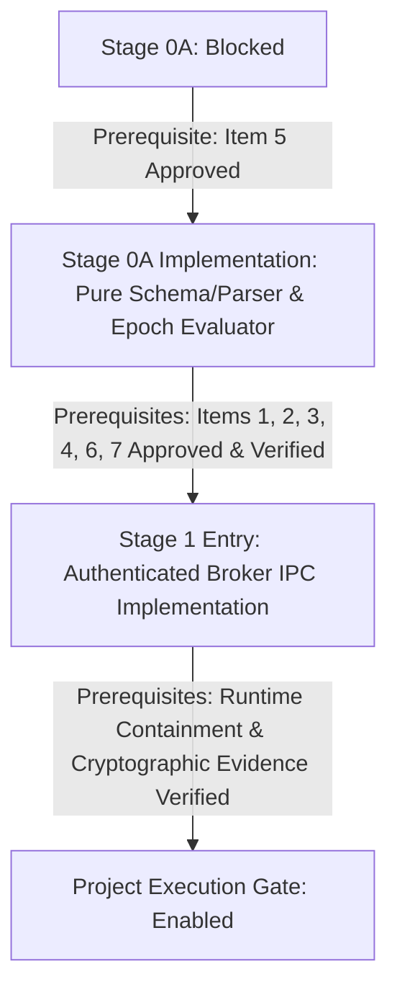

# Stage 0A Stakeholder Handoff Package: External Evidence & Readiness Prerequisites

## 1. Executive Summary & Purpose

This document serves as the authoritative handoff package for external stakeholders regarding **AI Help Agent Stage 0A**. It consolidates all unresolved external dependencies, required evidence artifacts, responsible stakeholder roles, and acceptance criteria necessary before any stage progression can be authorized.

> [!CRITICAL]
> **Important Disclaimers:**
> - **Design documents, architectural proposals, threat models, and code comments do not constitute formal approval.**
> - **Passing offline synthetic tests (such as injected lifecycle, parser, or mock suites) proves contract conformance only; it does not establish OS-level containment or real Windows runtime acceptance.**
> - **No production private key, mock signature verifier, default trust root, or test-only bypass path may ever be accepted as runtime evidence.**

---

## 2. Gate Disposition

The AI Help Agent operates under a strict **fail-closed** security architecture. The current stage gates are formally recorded as follows:

| Stage Gate | Current Status | Disposition Detail |
|---|---|---|
| **Stage 0A** | **`BLOCKED`** | Credential-independent validation implementation cannot proceed until the canonical specification is formally approved. |
| **Stage 1 IPC** | **`NOT STARTED`** | Authenticated IPC implementation remains strictly prohibited until Stage 0 and Stage 0A prerequisites are verified. |
| **Project Execution Gate** | **`BLOCKED`** | Windows sandbox execution is disabled. All unauthenticated host observations remain `NOT_ESTABLISHED`. |

---

## 3. Unresolved Requirements & Stakeholder Handoff Matrix

The following table details each unresolved requirement, the documented accountable stakeholder role, the exact evidence artifact required, acceptance criteria, and its authoritative status.

*Status Definitions:*
- **`BLOCKED`**: Progress cannot proceed because a preceding architectural, governance, or specification prerequisite has not been completed.
- **`PENDING`**: A specification or proposal is documented and awaiting formal governance review and sign-off.
- **`NOT_ESTABLISHED`**: The runtime claim, observation, or boundary has no authoritative host backing or verification mechanism.

| # | Requirement Area | Documented Role | Status | Required Approval or Evidence Artifact | Acceptance Criteria & Independent Verification |
|---|---|---|---|---|---|
| **1** | **Authoritative Host Process Observation** | **Platform/Windows Team** | `NOT_ESTABLISHED` | **Host-Side Process Lifecycle Architecture & Evidence Log** Documented mechanism and proof of host-level binding to sandbox processes. | **Criteria:** Host must independently bind launcher PID and container VM identity, tracking process tree termination without relying on guest claims or global client counts. **Verification:** Tested on supported Windows hosts under concurrent instances, abnormal termination, and timeout. |
| **2** | **Verifiable Sandbox-Resource Absence** | **Platform/Windows Team** | `NOT_ESTABLISHED` | **Resource Teardown Verification Procedure & Signed Proof** Diagnostic evidence proving destruction of sandbox VM memory, container storage, and virtual disk leases. | **Criteria:** Host must independently verify the complete post-shutdown destruction of all VM artifacts, ephemeral storage, and mounts, refusing reuse or lease clearance on residual presence. **Verification:** Host-side storage and hypervisor query inspection confirming absence of resources after client exit. |
| **3** | **Host-Side Handle-Release Evidence** | **Platform/Windows Team** | `NOT_ESTABLISHED` | **Production Handle Inspection Integration & Test Evidence** Integration using native Windows handle query APIs confirming all handles to staging/workspace paths are closed. | **Criteria:** Resource lease may only be released when all filesystem and process handles are confirmed closed by the host OS. **Verification:** Stress testing with delayed handle closing and simulated handle retention failure modes. |
| **4** | **Authenticated Result-Channel & Provenance Contract** | **Release/Security Team** | `BLOCKED` | **Approved Tamper-Proof Transport Specification & Integrity Proof** Formally approved architecture for guest-to-host reporting (e.g. authenticated named pipe with process SID checks or broker stream). | **Criteria:** Guest-executed untrusted code cannot forge, replace, replay, or intercept `result.json` or `cleanup.json`. Host rejects unauthenticated or mismatched payloads fail-closed. **Verification:** Penetration and tamper testing attempting guest-side report fabrication and cross-run report injection. |
| **5** | **Canonical Trust Policy & Release Manifest Specification** | **Release/Security Team** *(with Electron Main Platform Owner)* | `PENDING` | **Approved Canonical Trust Policy Specification Document** Formally approved, versioned specification covering exact manifest schema, canonicalization rules, and cryptographic identity. | **Criteria:** Complete definition of JSON canonicalization, cryptographic publisher identifiers (public key / thumbprint pin), artifact digest bindings, SemVer/epoch precedence, and revocation handling. **Verification:** Formal review and sign-off document from Release Owner and Security Reviewer. |
| **6** | **Anti-Downgrade & Monotonic Epoch Protection Mechanism** | **Release/Security Team & Platform/Windows Team** | `BLOCKED` | **Protected State Architecture Specification** Specification for monotonic minimum-version and policy-epoch persistence in service-protected storage. | **Criteria:** System detects and rejects replay of older validly-signed binaries or rolled-back policy epochs; missing or corrupt state store strictly halts broker startup and keeps execution blocked. **Verification:** Rollback injection, snapshot restoration, and ACL tampering test cases. |
| **7** | **Windows Runtime Acceptance & Independent Results** | **Independent Windows Test Owner & Security Reviewer** | `BLOCKED` | **Independent Runtime Acceptance Report & Test Logs** Documented acceptance test plan executed on actual target Windows platforms with genuine release-signed artifacts. | **Criteria:** Proves end-to-end fail-closed behavior under simulated process crashes, network loss, tampering, and timeout without relying on mocks or test fixtures. **Verification:** Independent execution and sign-off by testing team on physical/virtualized clean Windows instances. |

---

## 4. Stage Transition Prerequisites

Transition between security stages requires satisfying explicit, auditable criteria:

### A. Prerequisites to Unblock Stage 0A Implementation
Before credential-independent validator, schema parser, or version evaluator code can be implemented:
1. **Approval of Item 5 (Canonical Trust Policy Specification):** The Release Owner and Security Reviewer must formally sign off on the canonical schema, normalizer rules, publisher representation, and epoch precedence.
2. **Implementation Scope Lock:** The resulting implementation must be purely offline, deterministic, and free of any mock signing, fake certificates, default trust roots, or test-only bypass paths.

### B. Prerequisites to Authorize Stage 1 IPC Entry
Stage 1 (authenticated client-to-broker IPC protocol and service integration) may **not** begin until:
1. Release owners document publisher and offline trust-root custody.
2. Signed client and broker release policies exist.
3. The installer and updater enforce Authenticode signatures, protected paths (`Program Files`), monotonic epoch state, and fail-closed recovery.
4. Independent Windows review verifies the actual running service image, token SID, and signer on supported Windows OS builds.
5. All 7 items in the Stakeholder Handoff Matrix have progressed from `BLOCKED` / `NOT_ESTABLISHED` to formally verified and approved.

---

## 5. References to Existing Technical Documentation

- **[`docs/trusted-host-evidence-issuer-design.md`](file:///C:/Users/Admin/eclipse-workspace/copilot-worktrees/Ai_Help_Agent/ayush1303199-fictional-disco/docs/trusted-host-evidence-issuer-design.md):**
  - Host observation and trusted evidence issuer threat model (lines 25–70).
  - Broker service identity, protected installation, and anti-downgrade design (lines 370–445).
  - Stage 0A credential-independent validation requirements (lines 516–594).
- **[`docs/windows-sandbox-cleanup-reporting.md`](file:///C:/Users/Admin/eclipse-workspace/copilot-worktrees/Ai_Help_Agent/ayush1303199-fictional-disco/docs/windows-sandbox-cleanup-reporting.md):**
  - Status and decision: untrusted guest reporting channel (lines 1–39).
  - Required cleanup evidence contract and parser schema (lines 117–151).
  - Trust-boundary requirements and independent shutdown invariants (lines 152–196).
  - Implementation gates and acceptance criteria (lines 197–230).
- **[`electron/coding-pipeline/sandboxResourceLifecycle.cjs`](file:///C:/Users/Admin/eclipse-workspace/copilot-worktrees/Ai_Help_Agent/ayush1303199-fictional-disco/electron/coding-pipeline/sandboxResourceLifecycle.cjs):**
  - Resource lease, staging removal, and quarantine state enforcement.
- **[`electron/developerFiles.cjs`](file:///C:/Users/Admin/eclipse-workspace/copilot-worktrees/Ai_Help_Agent/ayush1303199-fictional-disco/electron/developerFiles.cjs):**
  - Fail-closed isolation enforcement and untrusted result channel declaration (`WINDOWS_SANDBOX_RESULT_CHANNEL_AUTHENTICATED = false`).
